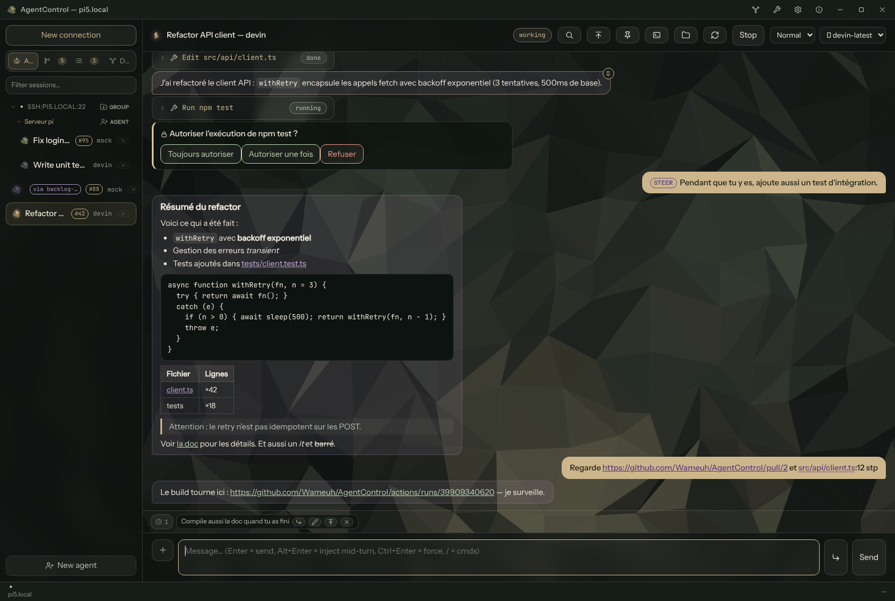
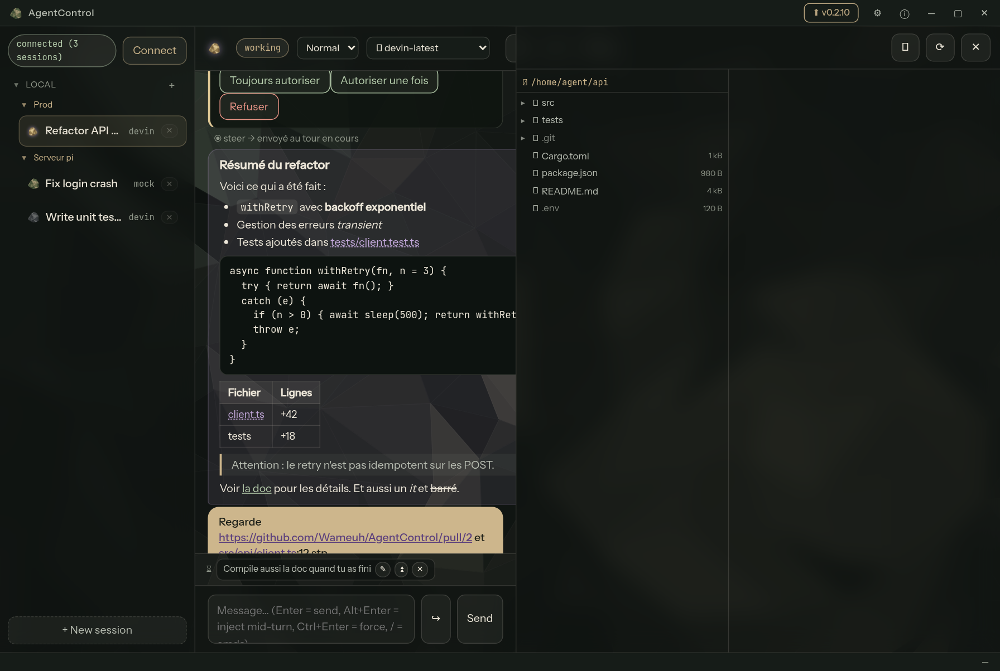
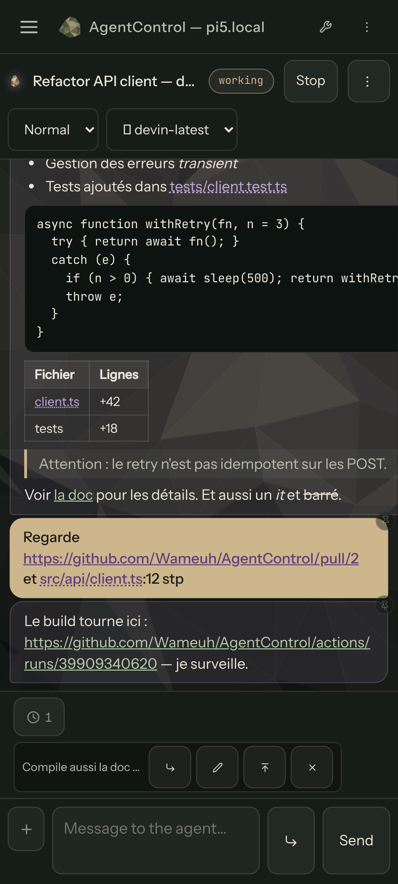
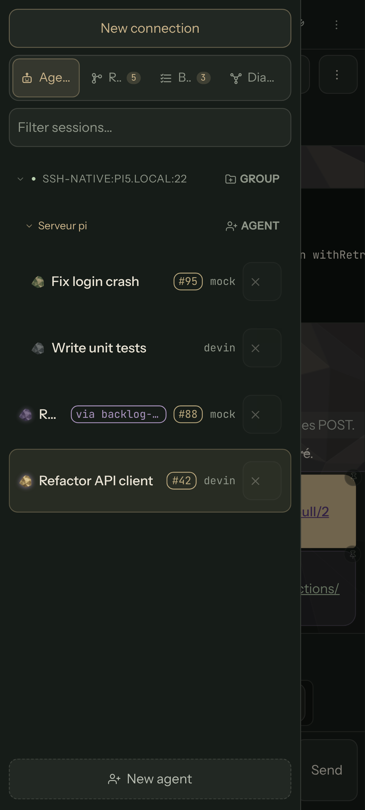
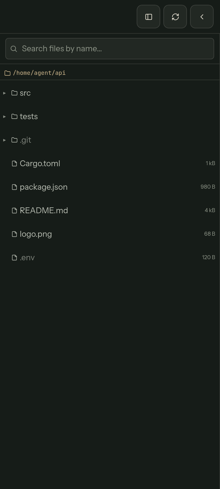

# AgentControl

Client léger (Tauri) pour piloter des **agents ACP détachés** tournant sur un
serveur Ubuntu. Fermez l'appli : les agents continuent. Rouvrez : historique
complet, reprise des sessions, réponses aux permissions/questions en attente.

Voir `ANALYSE.md` pour la conception.

## Captures d'écran

### Bureau (Ubuntu / Windows)

Chat — rendu markdown des réponses agent, groupes de sessions (glisser-déposer),
file d'attente de prompts :



Explorateur de fichiers distant — aperçu d'images et lecteur vidéo
streamé (ranges HTTP via le schéma `acvideo://` → tranches `read_file`
démon ; seul le buffer consommé est transféré, pas le fichier entier) :



### Android

Interface native mobile : drawer de sessions, bulles de chat markdown,
explorateur plein écran, menus en bottom sheets.

| Chat | Sessions & groupes | Explorateur |
|:-:|:-:|:-:|
|  |  |  |

Les captures sont générées par le harnais de test : `cd client && npm run build
&& node tests/readme-shots.mjs` (Chromium headless + mock Tauri, viewports
desktop & Android).

## Architecture

```
portable (Tauri)                serveur Ubuntu
┌─────────────────┐   SSH -L    ┌──────────────────────────────┐
│ client-core ────┼────────────►│ agentcontrol-daemon          │
│ UI chat/events  │  NDJSON     │  ├─ devin acp   (enfant)      │
└─────────────────┘  unix/tcp   │  ├─ cursor-agent acp (enfant) │
                                │  ├─ codex-acp …  (enfant)     │
                                │  └─ ~/.agentcontrol/sessions │
                                └──────────────────────────────┘
```

- `crates/daemon` — le démon (possède les process agents, journalise tout)
- `crates/proto` — protocole client↔démon + modèle d'événements
- `crates/client-core` — transports (unix/tcp/ssh -L) + client protocole
- `crates/mock-agent` — agent ACP factice pour tester sans abonnement
- `crates/acctl` — client CLI de test
- `client/` — app Tauri (frontend TS vanilla, ~11 KB JS)

## Build

```bash
cargo build --release          # démon + acctl + mock
```

## Démon (sur le serveur)

```bash
# directement
AGENTCONTROL_HOME=~/.agentcontrol ./agentcontrol-daemon

# ou déploiement systemd --user depuis votre poste :
./packaging/deploy.sh user@serveur
```

Écoute : `~/.agentcontrol/daemon.sock` + `127.0.0.1:7331` (loopback → tunnel SSH).
Agents configurés dans `~/.agentcontrol/config.toml` (voir `packaging/config.example.toml`).

### Agents supportés

Tout agent parlant ACP sur stdio fonctionne ; chaque entrée `[agents.<id>]`
de la config définit sa commande et ses env (placeholders `{model}`/`{mode}`
substitués à la création de session, omis si vides). `list_agents` rapporte
`available` (binaire résolvable) — le picker UI grise les agents absents.

- **Devin** : `devin acp` (défaut). Mode via `DEVIN_PERMISSION_MODE={mode}`.
- **Cursor** : `cursor-agent acp` (ACP natif). `cursor-agent login` requis.
- **Codex** : pas d'ACP natif → adaptateur `npm i -g @agentclientprotocol/codex-acp`
  + env `CODEX_PATH` = chemin absolu du binaire codex (évite le codex npm
  embarqué — requis sur arm64). Node doit être sur le PATH du démon
  (`~/.nvm/versions/node/*/bin` est auto-détecté, `$NVM_BIN` prioritaire).
- **Claude** : adaptateur `npm i -g @agentclientprotocol/claude-agent-acp`
  (embarque le Claude Agent SDK — le CLI `claude` n'est pas requis).
  Auth : `ANTHROPIC_API_KEY` ou `CLAUDE_CODE_OAUTH_TOKEN`
  (`claude setup-token`, fonctionne en headless) dans `[agents.claude.env]`.

Modes/modèles demandés à la création : substitués dans command/env si le
profil utilise les placeholders, sinon appliqués via `session/set_config_option`
quand la valeur figure dans les options annoncées par l'agent.

## Client Tauri

```bash
cd client
npm install
npx tauri dev      # nécessite webkit2gtk-4.1 sous Ubuntu :
                   # sudo apt install libwebkit2gtk-4.1-dev
npx tauri build    # binaire natif
```

Connexion SSH : type « SSH », `user@serveur` — le client ouvre
`ssh -N -L <port>:127.0.0.1:7331` automatiquement (clés/agent ssh standard).

### macOS

`.dmg` arm64 dans l'artifact `agentcontrol-client-macos` (releases et
builds de PR) : ouvrir le dmg, glisser `AgentControl.app` dans
`/Applications` (ou `~/Applications`).

**App non signée** — le compte Apple Developer (certificat +
notarisation `notarytool`) est une étape prévue mais pas encore en
place : au premier lancement Gatekeeper bloque → clic droit sur l'app →
**Ouvrir**, ou :

```bash
xattr -dr com.apple.quarantine /Applications/AgentControl.app
```

- **Update in-app** : le chip « ⬆ vX » / le dialogue « client périmé »
  télécharge le `.dmg` de la release, remplace le `.app` et relance —
  sans quarantine à lever (téléchargement direct, hors navigateur).
- **Raccourcis** : `Cmd` remplace `Ctrl` (Cmd+Entrée = envoi forcé,
  Cmd+S = enregistrer le fichier, Cmd+F = recherche).
- **Fullscreen Spaces (⌃⌘F)** : indisponible sur fenêtre borderless
  (decorations custom) — le bouton maximize couvre l'écran à la place.
- Le canal rc suit la même limite que Windows : l'artefact rc
  s'identifie `X.Y.Z` (CFBundleVersion exige du numérique) → pas de
  chaîne auto-update rc→rc+1, réinstallation manuelle.

## Test CLI (acctl)

```bash
export AGENTCONTROL_SOCK=~/.agentcontrol/daemon.sock
acctl agents                          # agents configurés
acctl new devin ~/projet --title t    # nouvelle session
acctl list                            # sessions (état : idle/working/waiting_input/asleep/dead)
acctl send s-xxx "corrige les tests"  # envoyer un message
acctl tail s-xxx                      # suivre en live
acctl events s-xxx                    # paginer l'historique
acctl respond s-xxx pr-xxx allow_once # répondre à une permission
acctl mode s-xxx bypass               # changer de mode à chaud
acctl resume s-xxx                    # reprendre (session/load)
acctl sleep s-xxx                     # endormir (libère le process)
acctl kill s-xxx / cancel s-xxx
```

`acctl sleep` met une session en sommeil : le process agent est tué (CPU/
mémoire libérés) mais la session native, le journal et la file de prompts
sont préservés. Une session endormie (état `asleep`) se réveille
automatiquement au prochain `send` ou message agent→agent — le démon la
respawne via `session/load` comme un `resume`. Le client propose la même
action (« Endormir » dans le menu session, `/sleep` builtin) ; ouvrir une
session endormie n'a pas d'effet, c'est l'envoi qui la réveille.

## État validé (e2e)

- spawn `devin acp` réel via le démon, prompts, chunks compactés, tool calls
- permission → `waiting_input` persistant → réponse après reconnexion
- elicitation (ask_user_question) relayée
- sorties > 32 KB externalisées en blob + relecture
- `set_mode` à chaud, `session/load` (reprise), restart démon → `interrupted` → resume
- subscribe live + rattrapage par seq

## Agent↔agent

Chaque session reçoit (via `mcpServers` ACP) un serveur MCP `agentcontrol`
exposant 5 outils : `agentcontrol_list_sessions` (découverte des pairs),
`agentcontrol_send_message` (`delivery: "queue"` = fin de tâche, `"steer"` =
injection après le tool call courant si l'agent le supporte),
`agentcontrol_create_session` (délégation : spawn d'une nouvelle session
avec la `task` comme premier prompt), `agentcontrol_read_events`
(transcript d'un pair) et `agentcontrol_sleep_session` (endort une session
— libère son process ; elle se réveille seule au prochain message).

Le message est journalisé `peer_message` dans les deux sessions (rendu
dédié côté client, cliquable vers la session pair) et livré à la cible
comme prompt préfixé de la provenance. Une session morte est relancée
automatiquement. Anti-boucle : `rate_per_min` (20/min/paire, section
`[a2a]` de config.toml — `enabled = false` pour tout couper).

Création de session par un agent (`agentcontrol_create_session` /
`peer_spawn`) : les champs omis héritent de la session créatrice (agent,
cwd, groupe ; modèle/mode seulement si même agent). La création et la
tâche déléguée sont tracées dans les deux journaux (events `system` +
`peer_message`), et la session fille connaît l'id de sa créatrice pour
répondre via `agentcontrol_send_message`. Anti-boucle dédié : `spawn_per_min`
(10/min/créatrice, `0` = illimité) et `spawn_max_sessions`
(20 sessions agent→agent au total, `0` interdit le spawn) — le cap
global borne le fan-out récursif, chaque fille étant une créatrice.

Fallback sans MCP : `AGENTCONTROL_SOCK`/`AGENTCONTROL_SESSION` sont dans
l'env de l'agent → `acctl msg <from> <to> [--steer] <texte>` et
`acctl spawn <from> [tâche...]`.
