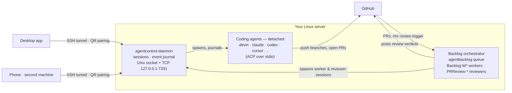
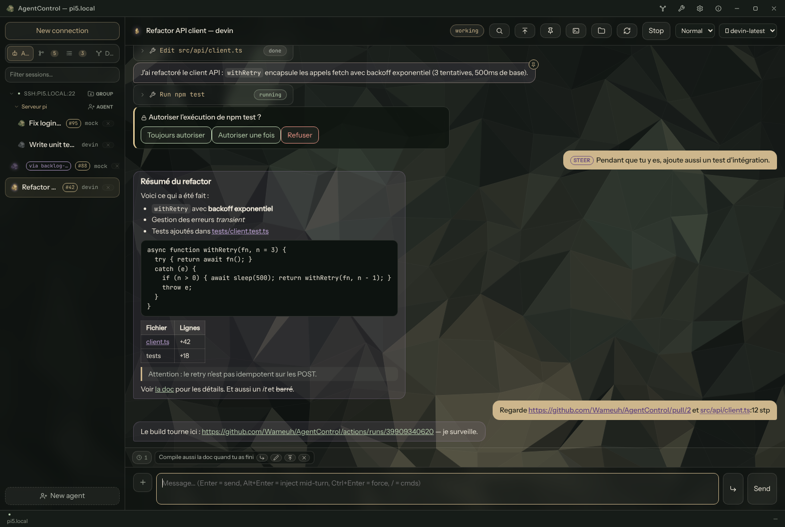
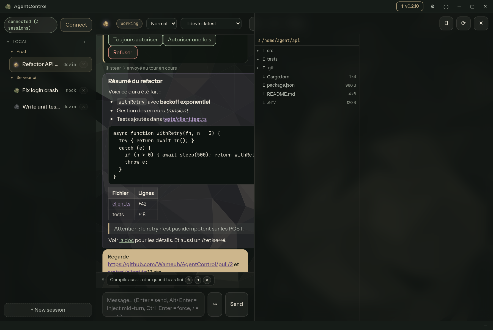
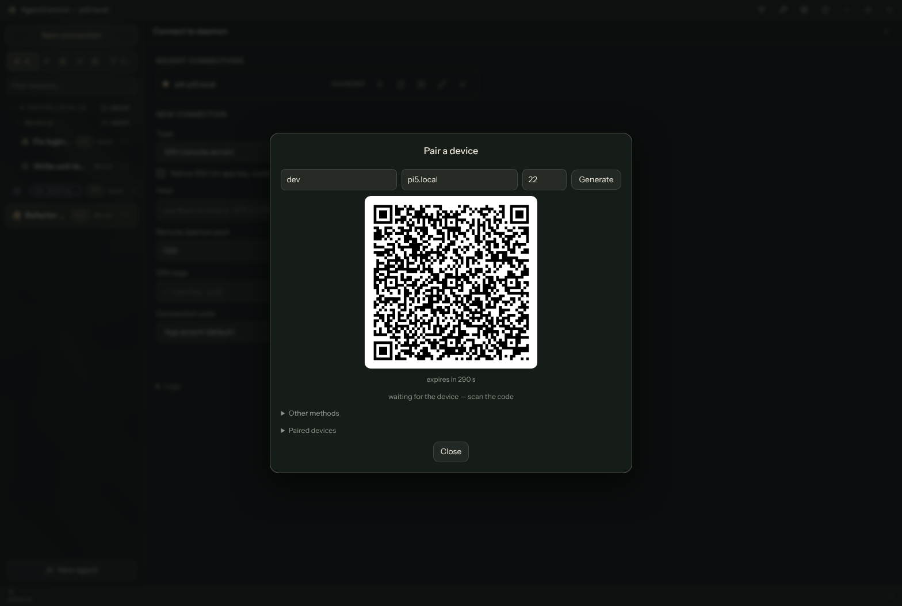
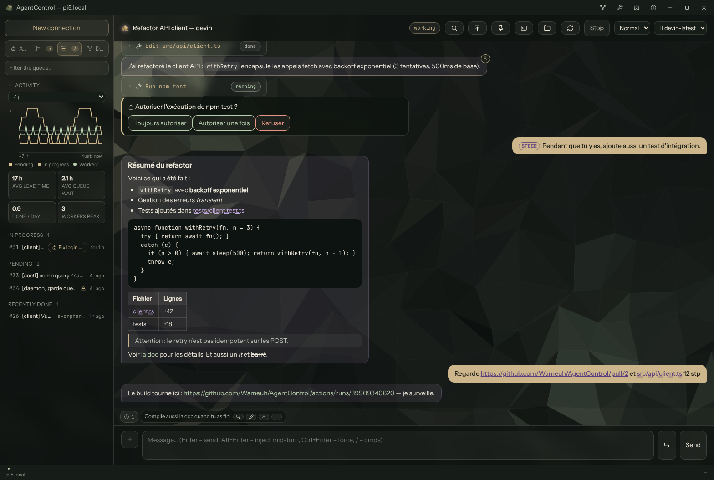
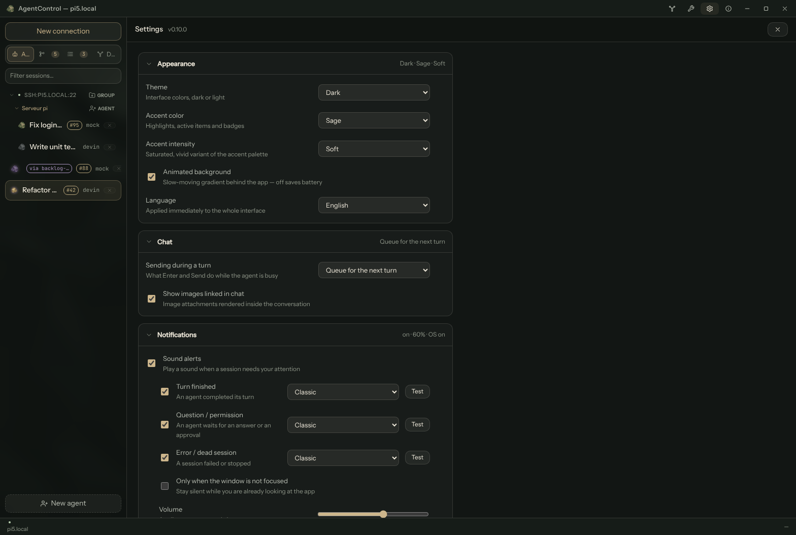
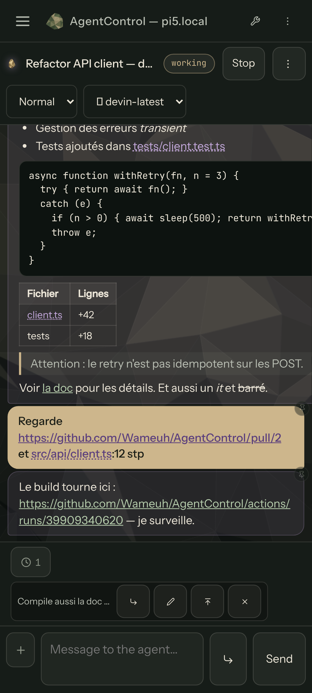
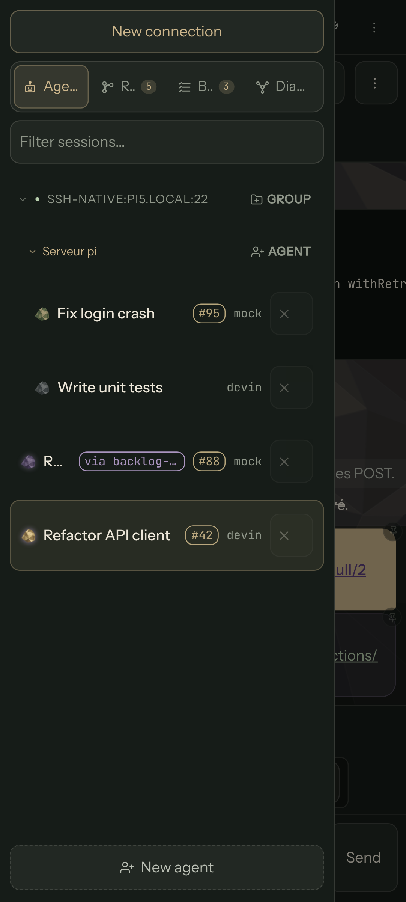
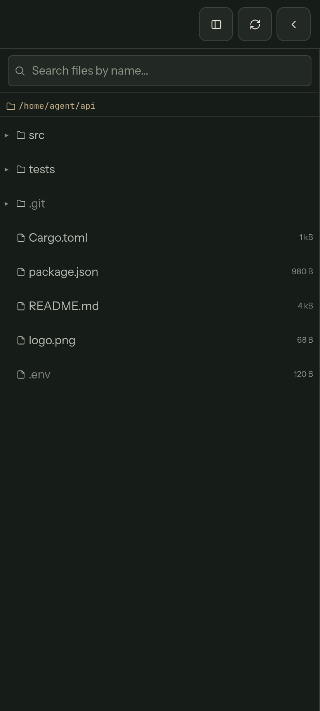

# AgentControl

**Mission control for your coding agents — they run on your server, you
drive them from anywhere.**

AgentControl is a lightweight desktop & mobile app that pilots AI coding
agents running **detached** on your own Linux server. Close the app:
nothing dies — the agents keep working. Reopen it on your laptop, your
phone, another machine: every session is there, full history, pending
questions, mid-task.

Run several agents in parallel, on one server or many. Organize them,
queue their work, let them delegate to each other — and supervise the
whole fleet from your desk or your couch.

How the pieces fit together:



## Screenshots

Markdown chat with expandable tool calls, pending permissions, session
groups, a prompt queue and pull-request tracking — desktop:



Browse the remote workspace: file tree, in-app editing, image, video and
PDF preview:



Pair a phone (or a second machine) by QR — a one-shot key on the server,
the device keeps its own:



| Watch the shared backlog — queue, in-flight work, throughput | Tune the feel — themes, accents, sounds, notifications, updates |
|:-:|:-:|
|  |  |

Same sessions, same agents — native mobile UI on Android:

| Chat | Sessions & groups | Files |
|:-:|:-:|:-:|
|  |  |  |

## Install

### You need

- **A Linux server** (x86_64 or aarch64) reachable over SSH — that's
  where the agents run.
- **At least one coding agent** on that server. Anything that speaks
  [ACP](https://agentclientprotocol.com) over stdio works: Devin
  (`devin acp`) and Cursor (`cursor-agent acp`) natively, Codex and
  Claude through small adapters.
- **The app** on your machine — pick yours on the
  [**releases** page](https://github.com/Wameuh/AgentControl/releases):

  | Platform | Download |
  |---|---|
  | Windows | NSIS installer (`.exe`), `.msi`, or portable `.exe` |
  | macOS (Apple Silicon) | `.dmg` — on first launch, right-click the app → **Open** |
  | Ubuntu / Linux | `.deb`, AppImage, or the standalone binary |
  | Android | `.apk` (arm64) — allow installs from this source |

  Rather compile it yourself? See [build from source](#for-developers).

### First launch

1. Open the app → **New connection** → type `user@your-server`.
2. No daemon there? AgentControl offers to **install it for you** over
   SSH — binaries deployed and auto-started in seconds.
3. Hit **New agent**, choose the agent, a working directory, a model —
   send your first prompt. You can close the app now: the agent doesn't
   care, it keeps going.

SSH uses your existing keys and `~/.ssh/config`. No keys on that server?
The built-in SSH transport takes a password, or generates a dedicated
app key for you to authorize.

### Pairing a phone (or a second machine) by QR code

On a saved SSH connection, hit the **QR button** to pair a device in
seconds — on the other side, **Scan QR** in the connection form does
the rest:

- The desktop installs a **one-shot, short-lived key** on the server
  (a `restrict`-ed `authorized_keys` line bound to
  `~/.agentcontrol/pair.sh <nonce> <rport>`, ≤ 5 min, self-destructing
  on use) and shows a QR carrying that key plus the server's host-key
  fingerprints.
- The device scans, confirms `user@host`, authenticates with the
  one-shot key — the server's host key is **pinned by the scanned
  fingerprints** (a MITM can't slip in), and `pair.sh` installs the
  device's own key under `restrict,port-forwarding,permitopen`:
  forwarding is bound to `127.0.0.1:<rport>` (the daemon); shell exec
  stays available so the device can still install or upgrade the
  daemon remotely — `restrict` strips PTY, agent and X11 forwarding.
- The server answers `pair-ok:<fingerprint>` — verified against the
  device key — and the one-shot line disappears.
- Afterwards, every connection from that profile keeps **pinning the
  server host keys**: a divergence (rotation, MITM attempt) is flagged
  and requires explicit reconfirmation.

Two fallbacks stay available under *Other methods* in the pairing
dialog: **endpoint-only** (scan the address, install the device's
public key yourself) and **permanent credentials** (the profile's own
key/password — opt-in only, with a warning, for servers where the
hardened pairing can't run).

Housekeeping on the server: `~/.agentcontrol/pair.sh --sweep` removes
expired or orphaned one-shot lines and stale state files (orphans are
kept 24 h). A user `crontab` entry every 15 min is installed
automatically at the first pairing; pairings also trigger a sweep.
`~/.agentcontrol/pair.log` records timestamps, nonces, statuses and
fingerprints — never secrets — and paired devices can be revoked from
the dialog's *Paired devices* list.

## What you can do

A few concrete setups — every bullet is something you can do today:

- **Run many agents at once**, on one server or several. Every session
  is detached: kill the app, reboot your machine — the agents don't
  notice. If the server-side daemon itself crashes, working sessions are
  automatically resumed.
- **Hand a queue to the orchestrator**: the built-in backlog orchestrator
  drains the shared `agentbacklog` queue on its own — one worker session
  per item, an optional plan → review → implementation pipeline, and
  native PR reviews that watch your PRs, spawn read-only reviewers on the
  exact head and post the verdict as a comment. Worker and review
  concurrency, per-role agent profiles and repo routing are all tunable
  live — and a rate-limited provider triggers an automatic failover to
  another profile.
- **Pilot several agent providers side by side**: Devin and Cursor ship
  as built-in profiles; any ACP-speaking agent can be declared as a
  custom `[agents.*]` profile (Claude via `claude-code-acp`, Codex via
  its adapter…). Each orchestrator role — worker, planner, reviewer,
  PR reviewer — can run on a different profile, with its own model,
  mode and reasoning-effort level, and an optional advisor model.
- **Let agents wait without burning turns**: agents delegate long waits
  (CI checks, review verdicts, merges) to `ac-wait` — background waiters
  that wake the session the moment the condition fires, surviving even
  sleep. The sidebar shows an instrumented "wait-asleep" gem with the
  waiter's age, name and timeout.
- **Follow the PRs your agents open**: every PR is registered and synced
  automatically — the sidebar badges each session with its PRs, the
  Repos view shows review and CI state per PR (plus orchestrator review
  status), and foreign or merely-cited PRs stay out of the way.
- **Watch the live logs**: a dedicated panel tails the client and daemon
  log streams in near real time — level filters, pause/resume,
  auto-scroll, per-connection daemon selection.
- **Attach files to a prompt**: a button, drag & drop or a clipboard
  paste — files land in a per-session `.ac-uploads/` folder the daemon
  purges when the session is deleted.
- **Extend the app with plugins**: components can ship a rich plugin
  view — a sandboxed iframe with a bounded postMessage bridge that can
  run its declared queries and navigate, but never touch RPCs, sessions,
  files or other components.
- **Organize sessions into groups** — nested, drag & drop — filter them.
- **Drive several servers side by side**: one window per connection, each
  tinted its own color with the host in the title bar. Spawn another
  instance from a connection's context menu or the saved-connection
  picker — under the hood it's just `agentcontrol --conn <conn-key>`.
- **Queue messages** while an agent is busy, or **steer it mid-turn** to
  inject a correction right after the current step.
- **Let agents work together**: an agent can spawn sub-sessions,
  delegate tasks and exchange messages with its peers — you follow the
  whole conversation tree, and can fork a session into a second agent
  yourself.
- **Put sessions to sleep** to free CPU and RAM on the server; they wake
  up by themselves the next time you — or another agent — write to them,
  context intact.
- **Answer permissions and questions wherever you are**: approval
  prompts wait for you across disconnects.
- **Work the remote filesystem**: edit files in place (encoding-aware,
  conflict detection, undo/redo), preview images, stream video, read
  rendered markdown — with a live preview next to the editor for
  markdown files — download anything. The explorer watches the remote
  filesystem, so files written by an agent appear without a manual
  refresh, and its width is resizable.
- **Open a remote terminal** next to the chat when you need a shell.
- **Search and replay everything**: the daemon journals every event, so
  history is never lost.
- **Tune the feel**: dark & light themes, accent colors, animated
  background, sound alerts, English or French UI.
- **Stay up to date effortlessly**: the desktop app updates itself in
  place, upgrades the daemon on your server over SSH, and an opt-in
  channel serves release candidates.

Prefer a browser to an app? The daemon can also **serve the same UI over
HTTP** on the server (`bind_http` in `config.toml` — loopback + SSH
tunnel, token-protected): zero install on the client side.

## For developers

AgentControl is a Rust workspace (daemon, protocol, client core, CLI)
plus a Tauri 2 front end (vanilla TypeScript).

- Architecture, protocol and design rationale: [ANALYSE.md](ANALYSE.md)
- Review registry across forges (GitHub/GitLab/Gerrit):
  [docs/forges.md](docs/forges.md)
- Manual server setup & systemd unit:
  [packaging/INSTALL.md](packaging/INSTALL.md)
- Repo workflow & conventions: [AGENTS.md](AGENTS.md)

Build from source:

```bash
cargo build --release                          # daemon + CLI
cd client && npm install && npx tauri build    # desktop app
```

## License

[MIT](LICENSE)
